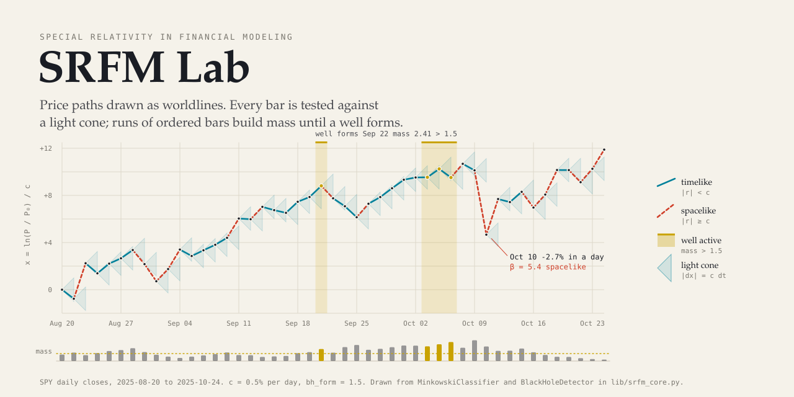
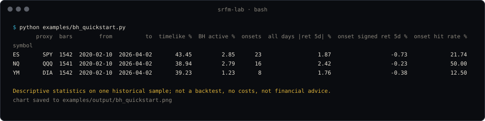
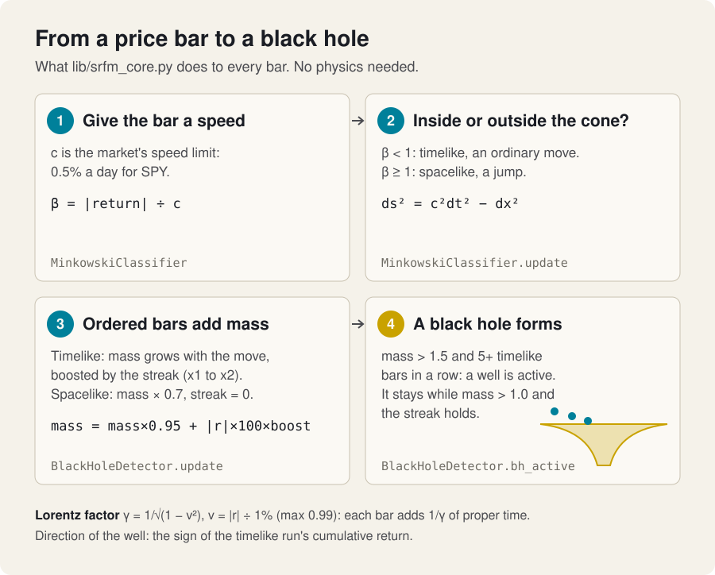
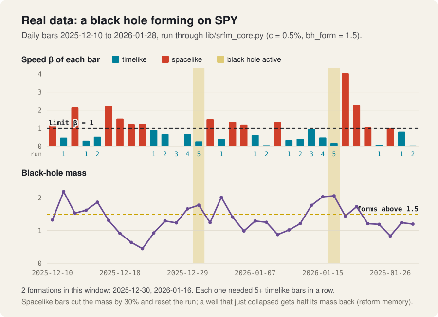
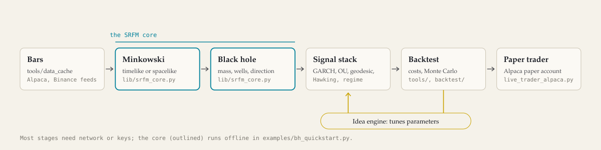
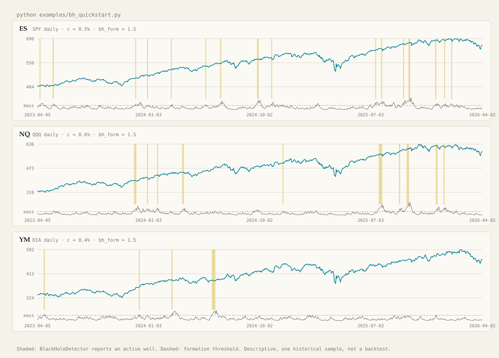
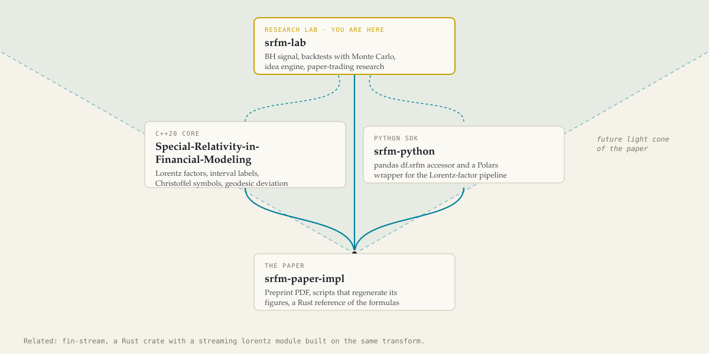

<picture>
  <source media="(prefers-color-scheme: dark)" srcset="assets/hero-dark.svg">
  
</picture>

<p align="center">
  <a href="https://srfm-lab.vercel.app/"><b>Project site</b></a> &nbsp;·&nbsp;
  <a href="#quick-start-one-command">Quick start</a> &nbsp;·&nbsp;
  <a href="#how-it-works">How it works</a> &nbsp;·&nbsp;
  <a href="#examples">Examples</a> &nbsp;·&nbsp;
  <a href="docs/REFERENCE.md">Full reference</a>
  <br><br>
  <a href="LICENSE"></a>
</p>

# SRFM Lab

English | [简体中文](README.zh-CN.md) | [日本語](README.ja.md) | [한국어](README.ko.md)

**A Python quant research lab that uses special relativity maths to label each market price bar as an ordinary move or a jump, and to spot "black holes": stretches where orderly moves pile up.** It is the hub of the SRFM (Special Relativity in Financial Modeling) family, with backtesting, Monte Carlo, paper trading and an idea-discovery engine built around that signal.

For quants, students and tinkerers who want to explore a physics-inspired trading signal on real data. It is a research monorepo, not a packaged product: the core runs offline on bundled data, while the wider lab (Rust, Go, Julia, R, C/C++, Zig, Elixir, TypeScript) needs API keys and services.

> [!IMPORTANT]
> **Research code, not financial advice.** Backtest and paper-trading results are experiments on historical or simulated data, not evidence that any strategy is profitable.

## Quick start: one command

Needs Python 3.12+. No API keys, no network after the install.

```bash
git clone -c core.longpaths=true https://gitlab.com/mattbusel/srfm-lab
cd srfm-lab
python quickstart.py
```

[`quickstart.py`](quickstart.py) creates `.venv/`, installs the pinned core from `requirements-core.txt`, and runs [`examples/bh_quickstart.py`](examples/bh_quickstart.py) on the hourly SPY, QQQ and DIA bars bundled in `tools/data_cache/`. `-c core.longpaths=true` lets the clone finish on Windows, where some committed build outputs exceed the 260-character path limit. There is no installer or `.exe`: this is research code, and the hosted [project site](https://srfm-lab.vercel.app/) shows the same results without installing anything.



## How it works

<picture>
  <source media="(prefers-color-scheme: dark)" srcset="assets/physics-explainer-dark.svg">
  
</picture>

In plain words: every bar gets a **speed** β, its return measured against a per-instrument "speed of light" `c`. Slow bars sit inside their **light cone** (timelike, `ds² = c²dt² − dx²` is positive); fast bars break out of it (spacelike). A run of orderly bars builds **mass**, and enough mass after five orderly bars in a row makes a **black hole**, a well that points the way the price has been drifting. The **Lorentz factor** γ = 1/√(1 − v²) turns each bar's speed into proper time. All of it is two small classes in [`lib/srfm_core.py`](lib/srfm_core.py): `MinkowskiClassifier` and `BlackHoleDetector`.

<picture>
  <source media="(prefers-color-scheme: dark)" srcset="assets/bh-formation-dark.svg">
  
</picture>

The chart above is the real classes run on real bundled bars ([`scripts/figures/make_physics_explainer.py`](scripts/figures/make_physics_explainer.py), regenerated 2026-09-28). The rest of the lab plugs into what these two classes emit:

<picture>
  <source media="(prefers-color-scheme: dark)" srcset="assets/pipeline-dark.svg">
  
</picture>

Deep dives: [BH physics](docs/bh_physics.md) · [IAE architecture](docs/iae_architecture.md) · [Execution stack](docs/execution_stack.md) · [Monte Carlo](docs/monte_carlo.md)

## Examples

Real output from 2026-09-28, on the data bundled in the repo.

**1. The default run** (the table in the terminal image above): ES, NQ and YM (SPY, QQQ, DIA as stand-ins), 2020-02-10 to 2026-04-02. Black holes were active on 1.2% to 2.9% of days. The 5-day return after each onset, signed by the well's direction, is negative on all three, which is the honest result: with these parameters the bare signal does not predict the next week.

**2. One instrument, a longer horizon**

```text
$ python quickstart.py --symbols ES --horizon 10
       proxy  bars        from          to  timelike %  BH active %  onsets  all days |ret 10d| %  onset signed ret 10d %  onset hit rate %
symbol
ES       SPY  1542  2020-02-10  2026-04-02       43.45         2.85      23                  2.64                   -0.27             56.52
```

**3. Every well on the chart.** The same run saves `examples/output/bh_quickstart.png`; here it is redrawn, with the wells shaded and the mass under each panel:

<picture>
  <source media="(prefers-color-scheme: dark)" srcset="assets/wells-dark.svg">
  
</picture>

## Use it in 3 steps

1. Clone and run `python quickstart.py` (above).
2. Change the question: `--symbols ES,NQ`, `--horizon 10`, or edit `PARAMS` (speed of light `cf`, threshold `bh_form`) in `examples/bh_quickstart.py`.
3. Go further: `pip install -r requirements-dev.txt && pytest tests -q` (what CI runs), then the backtests, Monte Carlo and paper trader in [docs/REFERENCE.md](docs/REFERENCE.md#the-full-lab).

## The SRFM family

<picture>
  <source media="(prefers-color-scheme: dark)" srcset="assets/family-dark.svg">
  
</picture>

| Repository | What it is |
|---|---|
| [srfm-paper-impl](https://gitlab.com/mattbusel/srfm-paper-impl) | The paper (PDF), scripts and a notebook that regenerate its figures, and a small dependency-free Rust reference implementation of the core formulas |
| [Special-Relativity-in-Financial-Modeling](https://gitlab.com/mattbusel/Special-Relativity-in-Financial-Modeling) | C++20 core and Windows/Linux command-line tools: price velocity (beta), Lorentz factor (gamma), spacetime interval labels, Christoffel symbols and geodesic deviation on OHLCV bars |
| [srfm-python](https://gitlab.com/mattbusel/srfm-python) | Pure-Python SDK: a pandas `df.srfm` accessor and a Polars wrapper for the Lorentz-factor pipeline |
| **srfm-lab** (this repo) | Large multi-language research lab that builds trading research on the idea: the black-hole (BH) physics signal, an idea automation engine, backtesting and paper trading |

The Rust crate [fin-stream](https://gitlab.com/mattbusel/fin-stream) also ships a streaming `lorentz` module built on the same transform.

## Documentation

| Document | What is in it |
|---|---|
| [docs/REFERENCE.md](docs/REFERENCE.md) | Everything else from the old README: the full lab (installs, crypto backtest + Monte Carlo, paper trading, analysis pipeline, IAE services), performance notes, module map, primitives by language, latency figures |
| [docs/bh_physics.md](docs/bh_physics.md) | The black-hole physics in depth |
| [docs/iae_architecture.md](docs/iae_architecture.md) | The Idea Automation Engine |
| [docs/wave4_backtest.md](docs/wave4_backtest.md) · [docs/monte_carlo.md](docs/monte_carlo.md) | Backtest and Monte Carlo engines |
| [docs/runbook.md](docs/runbook.md) | Running the live services |
| [RESULTS.md](RESULTS.md) · [HYPOTHESIS.md](HYPOTHESIS.md) · [JOURNAL.md](JOURNAL.md) | Research results, hypotheses and the lab journal |
| [CONTRIBUTING.md](CONTRIBUTING.md) · [CHANGELOG.md](CHANGELOG.md) | Contributing and version history |

## License

MIT, see [LICENSE](LICENSE). Research code, provided as is and not financial advice.
